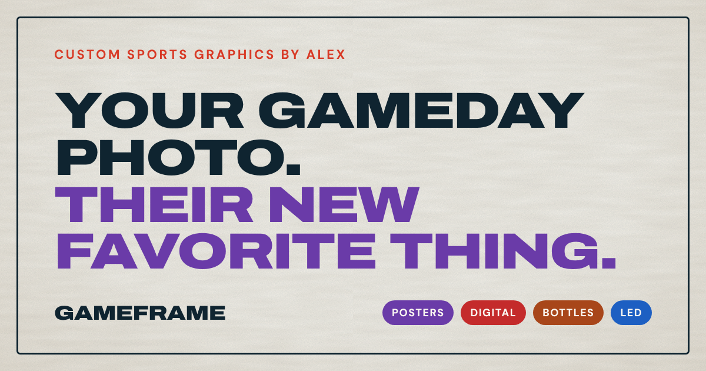

# GameFrame

**[Live Site →](https://alexstaplesdesign.github.io/gameframe-website/)**

Website for GameFrame — gameday photos turned into fan gear: posters, digital
copies, custom water bottles, and LED signs. One page, one call to action:
message Alex on Facebook Messenger.

## Stack

A single `index.html` with its CSS and vanilla JavaScript inline. No build step,
no framework. Fonts: Archivo (headings) and DM Sans (body) from Google Fonts.

## Running it

Open `index.html` in a browser, or serve the folder with any static server
(for example Live Server in VS Code).

## The homepage

- **Hero** — headline, Messenger button, and a showcase that flips through the
  four products. The headline's accent color changes to match each product.
- **Recent work** — eight samples that deal out like a deck when scrolled into view.
- **About Alex** — the story behind GameFrame.
- **Final call to action** — the Messenger "ticket" button.

## Changing the hero showcase

Each product is a tab button in the hero with these attributes:

| Attribute | What it does |
|---|---|
| `data-src` | Image to show (or `data-video` for a looping clip, plus `data-poster` for its still frame) |
| `data-alt` | Description for screen readers |
| `data-color` | Headline accent color while it's showing (`--c-poster`, `--c-digital`, `--c-bottle`, `--c-led` in `:root`) |
| `data-hold` | How long it stays up, in ms (default 3500) |
| `data-rate` | Video playback speed (default 1) |

## Images

The page loads web-sized copies from `media/web/`. The full-size originals stay
in `media/`. When you add or swap an image, save a copy about 700–900px wide as
`.webp` into `media/web/` and point the page at that.

## Other pages

These aren't linked from the homepage but still work at their own links:

- `payment.html` — payment reminder with Venmo, Cash App, and PayPal
- `tips.html` — thank-you page
- `portfolio.html` — the old full gallery
- `thank-you.html` — the old order-form confirmation
